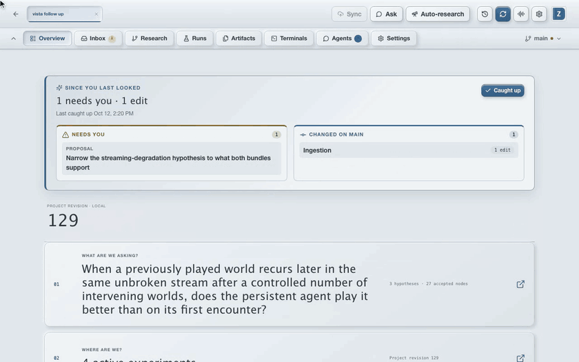
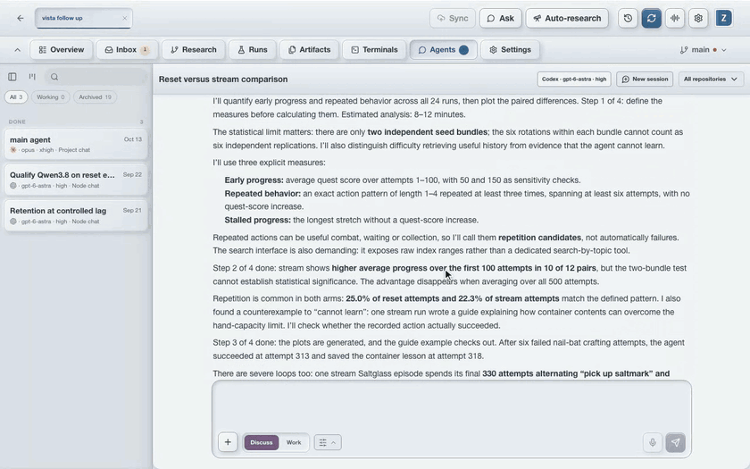
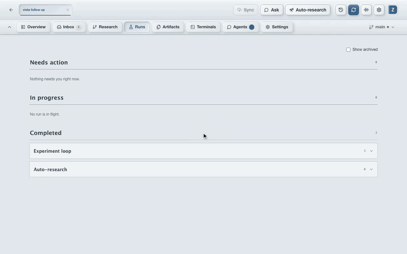
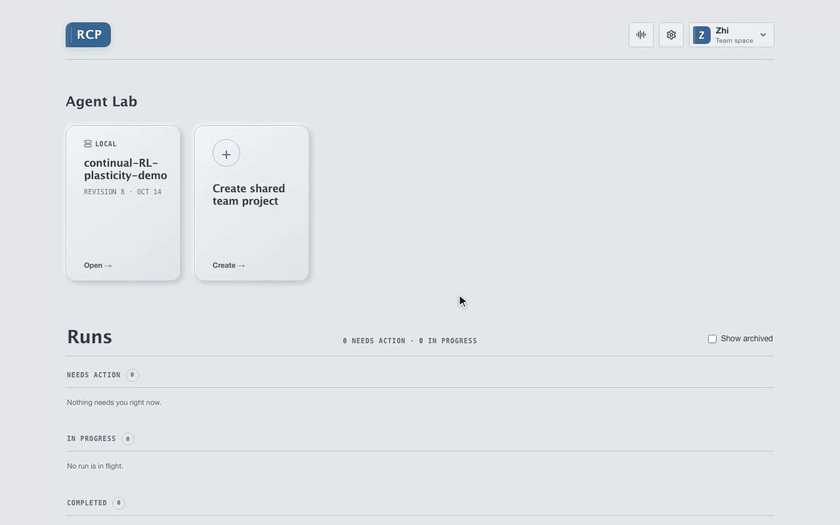
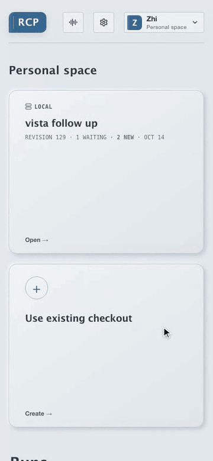

# RCP

Coding-agent sessions end, and findings get buried in separate chats.
Unverified claims can get repeated as facts.
RCP keeps one durable research graph; only a human can promote a claim to project truth.

**A control panel for research done with coding agents.** RCP turns your Codex
and Claude Code sessions into one durable research graph of questions,
hypotheses, experiments, evidence, and decisions. Agents propose; you decide.
Run it alone on a Mac, or share one team space with your lab on a Linux server.

## Who it's for today

- Researchers who run experiments with Codex, Claude Code, or OpenCode.
- Lab teams who want a shared record of questions, evidence, and decisions.

## What it does

- **One graph, append-only history.** RCP records questions, hypotheses,
  experiments, evidence, decisions, and blockers in a patch log. The log is
  replayable and versioned in Git.
- **Agents propose, you decide.** Agents create nodes and file Proposals; only
  a human approves one, promotes a claim to project truth, or authorizes an
  autonomous episode.
- **Bounded autonomy.** One click starts an Experiment or an Auto-research
  episode from the graph or a graph branch, with a budget and a Stop.
- **Work between sessions.** Watchers, recovery, and visual reports keep running
  without an open tab, and the phone UI shows them. A nightly pass merges
  duplicate nodes, and agents keep short operational lessons for later runs.
- **Artifacts in the reply.** Agents put pages, charts, and images right in
  their reply, running and interactive. Live pages redraw while a job runs.
  Select text or an image region to comment, and the agent that made it
  answers with a new version.
- **Agents that reach you.** An agent can stop and ask you a question. Proposals
  and questions arrive as notifications on the Mac and the phone.
  [Mac power controls](docs/specs/server-and-machine-operations.md#keeping-a-mac-awake)
  support ongoing work.
- **Talk to it.** Dictate into any chat, or open a voice session that answers
  questions about a project and starts or stops work when you say so.
- **Agents that browse.** A per-chat grant gives an agent a headless browser
  to check pages and local services it started.
- **Your machines, your subscriptions.** Run Codex, Claude Code, or OpenCode
  locally or over SSH. Choose provider, runtime, and model settings per agent role. A team space
  on your own Linux server adds shared projects, member attribution, central
  Git checkouts, and backup and restore.

## Install and run

Start with [installation](docs/install.md) for the macOS app, a source checkout,
and development checks. For a shared team space, use the
[team-server runbook](docs/server.md). Native builds and verification live in
[the desktop guide](docs/desktop.md).

The [design and spec index](docs/design.md) explains product boundaries and
current behavior.
